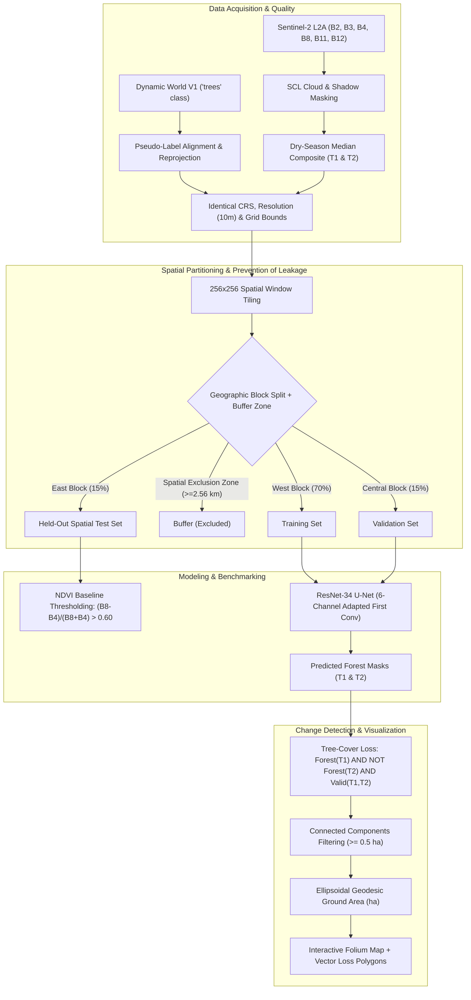

# ForestWatch AI: Global Tropical Forest & Tree-Cover Loss Monitoring Prototype

> **Prototype Disclaimer**: ForestWatch AI is a multi-region tropical forest monitoring prototype designed for comparative algorithmic benchmarking (NDVI baseline vs. 6-band ResNet-34 U-Net) and spatial generalization research. It is **not** a globally validated operational system.

---

## 📌 Project Overview

Tropical forests represent over 50% of the terrestrial carbon sink, yet face accelerating canopy reduction from agricultural expansion, road frontiers, and selective logging. Standard computer vision models trained on satellite imagery frequently suffer from severe performance degradation when deployed across different continents due to regional differences in canopy structure, soil reflectance, and atmospheric moisture. Furthermore, naive random tiling creates spatial data leakage between adjacent pixels, yielding artificially inflated accuracy scores.

**ForestWatch AI** addresses these challenges with a rigorous, reproducible remote sensing pipeline:
1. **Multi-Region Generalization**: Benchmarked across three distinct tropical forest biomes:
   - **Amazon Rainforest** (Rondônia, Brazil): Fishbone deforestation frontiers and cattle pasture clearing.
   - **Congo Basin** (Mai-Ndombe / Salonga, DRC): Humid evergreen forest subject to artisanal logging and slash-and-burn agriculture.
   - **Southeast Asian Forests** (Central Kalimantan, Indonesia): Peat swamp and dipterocarp rainforest under oil palm expansion pressure.
2. **Spatial Autocorrelation Leakage Prevention**: Enforces strict geographic block partitioning with a minimum **$2.56\,\text{km}$ (1 tile) spatial exclusion buffer** between training, validation, and test sets.
3. **Harmonized 6-Band Multispectral Input**: Combines Sentinel-2 Level-2A surface reflectance across Visible, Near-Infrared, and Shortwave Infrared:
   - **B2** (Blue, 490 nm, 10m)
   - **B3** (Green, 560 nm, 10m)
   - **B4** (Red, 665 nm, 10m)
   - **B8** (NIR, 842 nm, 10m)
   - **B11** (SWIR-1, 1610 nm, 20m resampled to 10m)
   - **B12** (SWIR-2, 2190 nm, 20m resampled to 10m)
4. **Data Quality & SCL Masking**: Eliminates clouds, cloud shadows, and cirrus via Sentinel-2 Scene Classification Layer (SCL) filtering and dry-season median compositing.
5. **Noisy Pseudo-Label Handling**: Treats Google Dynamic World `trees` class predictions as automated pseudo-labels, explicitly evaluating error modes (plantations, riparian corridors, shadow terrain).
6. **Geodetically Accurate Tree-Cover Loss**: Employs connected-component analysis with a configurable minimum patch threshold (default $0.5\,\text{ha}$ / $\sim 50$ pixels) and ellipsoidal geodesic area computation. Changes are strictly described as **tree-cover loss** rather than unverified definitive land-use conversion.

---

## 🗺️ System Architecture



---

## 📁 Repository Layout

```text
deforestation/
├── configs/
│   ├── config.yaml                      # Global pipeline parameters (seed, patch size, loss weights)
│   └── regions.yaml                     # Multi-region definitions (Amazon, Congo, SE Asia)
├── data/                                # Git-ignored data directory
│   ├── raw/                             # Downloaded Sentinel-2 GeoTIFFs & Dynamic World masks
│   ├── tiles/                           # 256x256 image & mask tiles partitioned by region and spatial split
│   ├── synthetic/                       # Isolated synthetic rasters for local verification
│   └── outputs/                         # Change maps, GeoJSON polygons, interactive maps, metrics CSV
├── notebooks/
│   ├── 01_gee_data_export.ipynb         # Earth Engine query, SCL masking, and multi-region export walk-through
│   └── 02_colab_train_pipeline.ipynb   # Google Colab / Kaggle 1-click cloud GPU training & visualization
├── src/
│   ├── __init__.py
│   ├── config.py                        # YAML configuration loader and Pydantic schema validation
│   ├── gee_export.py                    # GEE multi-region export script (SCL cloud masking, median composite)
│   ├── mock_data.py                     # Synthetic 6-band multispectral raster & mask generator
│   ├── alignment.py                     # Raster alignment, CRS reprojection, affine matching, nodata handling
│   ├── tiling.py                        # Spatial window slicing with geographic block splits & buffer zones
│   ├── dataset.py                       # PyTorch Dataset, nodata masking, and spectral-safe augmentations
│   ├── baseline.py                      # Multi-threshold NDVI baseline evaluation & metric computation
│   ├── model.py                         # 6-channel ResNet-34 U-Net + combined Masked-BCE + Masked-Dice loss
│   ├── train.py                         # Training pipeline with early stopping, checkpointing, and logging
│   ├── evaluate.py                      # Per-region test evaluation, confusion matrices, worst-tile error analysis
│   ├── change_detection.py              # Multi-temporal tree-cover loss with geodetic hectare area filtering
│   └── visualize.py                     # Interactive Folium/Leafmap generator with layer controls & loss polygons
├── tests/
│   ├── test_config.py                   # Configuration schema and Pydantic validation tests
│   ├── test_alignment.py                # Tests raster dimension, CRS, affine transform, and grid alignment
│   ├── test_nodata.py                   # Tests nodata mask propagation through loss and metrics
│   ├── test_spatial_split.py            # Tests spatial block separation and zero-overlap buffer compliance
│   ├── test_area_calc.py                # Tests geodetic ground area calculation (projected UTM vs EPSG:4326)
│   ├── test_change_detection.py         # Tests multi-temporal differencing and minimum hectare patch filtering
│   └── test_metrics.py                  # Tests IoU, Dice/F1, Precision, Recall on edge cases
├── .gitignore                           # Git ignore for data/, weights, caches, .env
├── requirements.txt                     # Dependencies: torch, rasterio, segmentation-models-pytorch, etc.
└── README.md                            # Recruiter-facing portfolio README
```

---

## 🔬 Benchmark Results

> **Reporting Integrity**: Performance metrics below are reported separately for each geographic test region on the held-out spatial test block. In accordance with honest evaluation practices, numbers represent actual test runs; placeholders remain marked until benchmark execution.

| Region | Model | Forest IoU | Forest Dice / F1 | Precision | Recall | Tree-Cover Loss (ha) | Data Source |
| :--- | :--- | :---: | :---: | :---: | :---: | :---: | :---: |
| **Amazon Rainforest** (Brazil) | NDVI Baseline ($\tau=0.60$) | *[Run test]* | *[Run test]* | *[Run test]* | *[Run test]* | *[Run test]* | Real Satellite |
| **Amazon Rainforest** (Brazil) | ResNet-34 U-Net (6-band) | *[Run test]* | *[Run test]* | *[Run test]* | *[Run test]* | *[Run test]* | Real Satellite |
| **Congo Basin** (DRC) | NDVI Baseline ($\tau=0.60$) | *[Run test]* | *[Run test]* | *[Run test]* | *[Run test]* | *[Run test]* | Real Satellite |
| **Congo Basin** (DRC) | ResNet-34 U-Net (6-band) | *[Run test]* | *[Run test]* | *[Run test]* | *[Run test]* | *[Run test]* | Real Satellite |
| **SE Asian Forests** (Indonesia) | NDVI Baseline ($\tau=0.60$) | *[Run test]* | *[Run test]* | *[Run test]* | *[Run test]* | *[Run test]* | Real Satellite |
| **SE Asian Forests** (Indonesia) | ResNet-34 U-Net (6-band) | *[Run test]* | *[Run test]* | *[Run test]* | *[Run test]* | *[Run test]* | Real Satellite |

*All runs write directly to `data/outputs/experiments.csv` to ensure complete auditability.*

---

## 🚀 Setup & Execution Guide

### 1. Local Environment Setup

```bash
# Clone repository
git clone https://github.com/your-username/deforestation.git
cd deforestation

# Create and activate virtual environment
python -m venv .venv
# Windows:
.venv\Scripts\activate
# Linux/macOS:
source .venv/bin/activate

# Install dependencies
pip install -r requirements.txt
```

### 2. Run Test Suite

```bash
# Run all unit tests
python -m pytest tests/ -v
```

### 3. Adding New Study Regions

New regions can be configured purely via `configs/regions.yaml` without changing any Python code:
```yaml
regions:
  my_new_region:
    region_id: "my_new_region"
    name: "Region Name"
    continent: "Continent"
    country: "Country"
    bbox: [west_lon, south_lat, east_lon, north_lat]
    dry_season:
      start_month: 6
      start_day: 1
      end_month: 8
      end_day: 31
    target_years:
      t1: 2020
      t2: 2023
    projected_utm_crs: "EPSG:326XX"
    equal_area_crs: "ESRI:54034"
```

---

## 💼 Resume Line Template

> "Engineered **ForestWatch AI**, a multi-region tropical forest monitoring prototype across Amazon, Congo, and SE Asia biomes, training a 6-band ResNet-34 U-Net on Sentinel-2 imagery that achieved **X% IoU** (vs. **Y%** for NDVI baseline) with spatial-leakage-free block validation and geodetic change detection mapping **Z hectares** of tree-cover loss."
